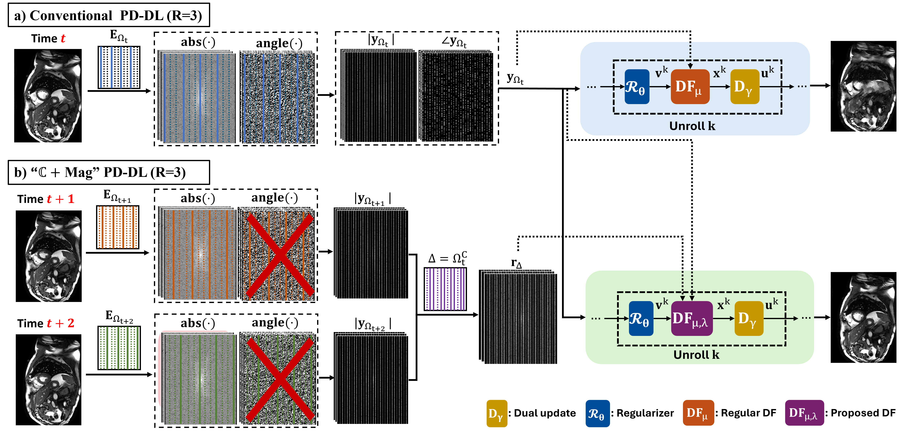

# C+Mag

[](https://ieeexplore.ieee.org/abstract/document/11735101)
[](https://arxiv.org/abs/2608.18036)
[](LICENSE)

**Harnessing Magnitude-Only and Complex Measurements for Improved Dynamic MRI Reconstruction with Learned Priors**
Mahdi Saberi, Yaşar Utku Alçalar, Merve Gülle, Chetan Shenoy, Mehmet Akçakaya
*IEEE Transactions on Biomedical Engineering (TBME), 2026*

<p align="center">
  
</p>

## Abstract

<p align="justify"> MRI reconstruction methods naturally use the acquired complex-valued k-space measurements, while phase retrieval theory suggests that magnitude-only measurements can provide complementary information. We show that in steady-state dynamic MRI, k-space magnitudes are highly consistent across time-frames, so neighboring frames supply informative magnitude measurements at unacquired locations with no additional scan time. Building on this, we propose <b>ℂ+Mag</b>, a magnitude-informed physics-driven deep learning (PD-DL) method that uses ADMM-based unrolling with a novel magnitude-aware data-fidelity formulation. On retrospectively undersampled cine and phase-contrast flow MRI, as well as prospectively undersampled real-time cine, <b>ℂ+Mag</b> improves artifact suppression, anatomical sharpness, and phase preservation over conventional PD-DL, further supported by blinded expert reader evaluations. </p>

## Installation

```bash
git clone https://github.com/MahdiSaberii/C_Plus_Mag.git
cd C_Plus_Mag
conda create -n cplusmag python=3.10
conda activate cplusmag
pip install -r requirements.txt
```

## Models

Select the model with `Network` in [`Config.yaml`](Config.yaml):

| `Network`                  | Data consistency            | Magnitude prior on unacquired lines            |
|----------------------------|-----------------------------|------------------------------------------------|
| `PDDL_Spatial`             | Conjugate gradient          | – (conventional PD-DL baseline)                |
| `MI_Spatial`               | Magnitude-inoformed GD (ℂ+Mag)  | From neighboring frames (`r` in the data)      |
| `MI_Oracle_Spatial`        | Magnitude-inoformed GD (ℂ+Mag)  | Oracle: magnitude of the fully sampled k-space |
| `PDDL_Spatiotemporal`      | Conjugate gradient          | –                                              |
| `MI_Spatiotemporal`        | Magnitude-inoformed GD (ℂ+Mag)  | From neighboring frames                        |
| `MI_Oracle_Spatiotemporal` | Magnitude-inoformed GD (ℂ+Mag)  | Oracle                                         |

*Spatial* models reconstruct one frame at a time. *Spatiotemporal* models reconstruct a stack of R frames jointly.

## Data

The experiments use segmented breath-hold cine data from the [OCMR dataset](https://www.ocmr.info). Set the data folders in the `paths` section of `Config.yaml` (`{R}` is replaced by the acceleration rate):

```
data/
├── train/R{R}/   subj_XXXX_slice_XXX_TXXX.mat   # one file per subject / slice / time frame
├── val/R{R}/     ...
├── test/R{R}/    ...
└── coils/        fs_XXXX_<scanner>_Slice_<n>.mat
```

We include one example frame, [`data/subj_0020_slice_001_T008.mat`](data/subj_0020_slice_001_T008.mat), and its coil sensitivity maps, [`data/coil_subj_0020_slice_1.mat`](data/coil_subj_0020_slice_1.mat), to show the expected file formats. Each frame file contains:

| Key             | Shape        | Description                                                   |
|-----------------|--------------|---------------------------------------------------------------|
| `kspace_t`      | `[H, W, Nc]` | Fully sampled multi-coil k-space of this frame (complex)      |
| `mask_t`        | `[H, W]`     | Undersampling mask of this frame                              |
| `r`             | `[H, W, Nc]` | Auxiliary k-space magnitude estimated from neighboring frames |
| `normalization` | scalar       | Normalization constant applied to the k-space data            |
| `nPhase`        | scalar       | Number of cardiac phases of the slice                         |
| `scanner_id`    | string       | Field strength, e.g. `"3T"` (used to find the coil file)      |

Coil files contain the sensitivity maps under the key `maps` with shape `[H, W, Nc]`. Training and test subjects are listed in the `subjects` section of the config.

## Usage

**Training**
```bash
python train.py
```
Checkpoints, loss and learned-parameter curves are written to `results/train/<experiment name>/`. The best model is saved as `model/BestModel_R{R}_Epoch{N}.pth`.

**Testing**

Set the model to evaluate in the `Test:` section of `Config.yaml` (its keys override the training settings), e.g.
```yaml
Test:
  R           : 8
  Network     : "MI_Spatial"
  model_epoch : 25        # loads BestModel_R8_Epoch25.pth
```
then run
```bash
python test.py
```
PSNR / SSIM per frame and per subject (`.csv`, `.mat`), reconstruction PNGs and one `.mat` file per slice are written to `results/test/<experiment name>/`.

## 📝 BibTeX

If you find this repository useful in your research, please consider citing our work:

```bibtex
@article{saberi2026cplusmag,
  title     = {Harnessing Magnitude-Only and Complex Measurements for
               Improved Dynamic {MRI} Reconstruction with Learned Priors},
  author    = {Saberi, Mahdi and Al{\c{c}}alar, Ya{\c{s}}ar Utku and
               G{\"u}lle, Merve and Shenoy, Chetan and Ak{\c{c}}akaya, Mehmet},
  journal   = {IEEE Transactions on Biomedical Engineering},
  year      = {2026},
  publisher = {IEEE},
  doi       = {10.1109/TBME.2026.3743233}
}
```
